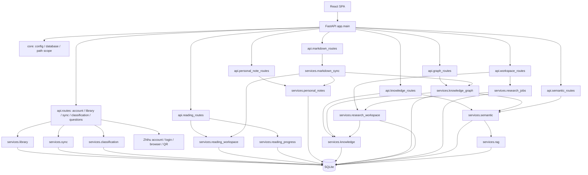
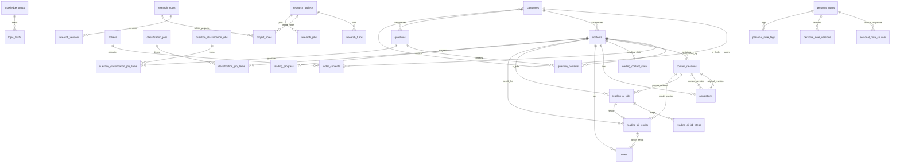

# V3 后端架构、API DTO 与 SQLite 关系图

> 代码基线：`refactor/v3`。本文件按当前 FastAPI router、Pydantic request model、service imports 与 SQLite schema 静态整理。它描述代码依赖和数据库强制外键；应用层的 `source_id` 软引用不等同于 SQLite 外键。修改路由、DTO、迁移或表结构时，必须同步更新本文。

## 1. 运行时分层



### 1.1 核心边界

- `app.main` 负责装配 router、生命周期、后台任务恢复/关闭；不应承载领域业务。
- `app.core.config` 负责资料库路径、AI 配置和 library scope；`app.core.database` 负责连接、schema 和版本迁移。
- `app.api.*` 负责 HTTP 路由、Pydantic 输入校验、HTTP 状态码/错误语义，不应直接编排复杂业务。
- `app.services.*` 负责领域规则、事务、证据校验和后台任务；数据库访问统一经 `session()`。
- `services.library` 是文章存取与时间/锁等基础服务；其他领域可调用它，但避免反向把所有业务塞回 library。
- `services.knowledge` 是 RAG/AI 证据组装与研究成果入口；`knowledge_graph` 管理主题、节点和显式链接。
- `services.research_jobs` 负责跨资料研究的可恢复任务生命周期；`reading_workspace` 负责单篇阅读 AI 工作流。
- `markdown_sync` 是文件系统边界适配器，可调用领域服务；导入必须校验文件路径、哈希、资料库归属与显式冲突决策。
- `services.zhihu_*` 是外部站点适配器；cookie/session 与网络自动化不得泄露给 API 日志。

## 2. HTTP Router 与 DTO 目录

所有路径以 `/api/v1` 为基准。表中列出请求 DTO（Response 主要由 service 返回 dict / typed result，仍需逐步补充显式 response_model）。

| Router | 路径/职责 | Request DTO | 关键校验/并发约束 |
|---|---|---|---|
| `api.routes` | `/health`、`/account/**`、`/folders/**`、`/settings/**`、`/categories/**`、`/contents/**`、`/ask`、`/sync-jobs/**`、`/classification-jobs/**`、`/questions/**` | `CategoryInput`, `ClassifyInput`, `SettingsInput`, `AISettingsInput`, `AskInput`, `SyncInput`, `ClassificationInput`, `LoginStartInput`, `LoginInput`, `ManualQuestionLinkInput`, `QuestionContentInput` | 字符长度、枚举、列表数量；登录请求幂等键；任务取消/重试状态校验 |
| `api.reading_routes` | 文章阅读上下文、进度、稍后阅读、批注、文章笔记、阅读 AI、阅读数据导入导出 | `NoteCreate`, `NotePatch`, `AnnotationCreate`, `AnnotationPatch`, `ReanchorInput`, `ReadingAIInput`, `ReadingProgressInput`, `ReadLaterInput`, `SearchInput`, `ReadingImportInput`, `ConvertResultInput` | revision 乐观锁；正文 revision ID；进度比例 0–1；AI action 枚举；request_key 幂等 |
| `api.personal_note_routes` | `/personal-notes/**` 独立个人笔记 CRUD、历史、批量删除 | `PersonalNoteCreate`, `PersonalNotePatch`, `PersonalNoteDeleteItem`, `PersonalNoteBulkDelete` | 标题≤1000、正文≤100000、来源≤32、标签≤12、revision≥1、批量≤50；整批校验后事务删除 |
| `api.knowledge_routes` | `/knowledge/search`、`/research-notes/**` | `EvidenceInput`, `ResearchInput`, `SaveInput` | 问题 2–2000；资料类型枚举；证据 chunk 2–16；版本乐观锁；模型错误统一映射 |
| `api.graph_routes` | `/knowledge/nodes`、`/links`、`/topics/**`、`/resolve-links` | `TopicInput`, `LinkInput`, `SourcesInput`, `ResolveInput` | 标题/正文长度；来源 1–16；节点 ID 与自引用校验；topic revision |
| `api.semantic_routes` | `/semantic`、`/evaluation-cases`、`/evaluate` | `EvaluationCase` | 问题 2–2000；预期来源 1–30；索引任务可取消 |
| `api.markdown_routes` | `/configuration`、`/preview`、`/import`、`/export`、`/sync` | `ConfigurationInput`, `ImportInput` | 目录路径和导入路径约束；逐文件 expected_hash；显式冲突/跨库恢复确认 |
| `api.workspace_routes` | `/knowledge/projects/**`、`/knowledge/versions/**`、`/knowledge/projects/{id}/jobs/**` | `CreateProject`, `ScopeInput`, `AskInput`, `RestoreInput`, `ResearchJobInput` | source 1–16；revision 乐观锁；单项目最多一个活动任务；任务状态机 |
| `api.graph_routes` | 同上知识图谱子域 | 同上 | 当前 prefix 为 `/api/v1/knowledge`，与知识问答/研究工作区共享前缀但职责分离 |

### 2.1 关键 DTO 字段

```text
EvidenceInput       question, category_id?, kinds[1..6]
ResearchInput       EvidenceInput + chunk_ids[2..16]
CreateProject       title, question, source_ids[1..16]
ScopeInput          revision>=1, source_ids[1..16], refresh
ResearchJobInput    AskInput(question, revision) + research:boolean
PersonalNoteCreate title, body_md, source_ids[0..32], tags[0..12]
PersonalNotePatch  title, body_md, revision>=1, source_ids?, tags?
AnnotationCreate   revision_id, anchor, color, comment_md, request_key?
ReadingAIInput      action(summary|explain|key_points), revision_id, selection_anchor?, force, request_key
ReadingProgressInput progress_ratio[0..1], scroll_y>=0, block_id?
SyncInput           mode(full|incremental), folder_ids[0..100]
AISettingsInput     base_url, chat_model, embedding_model?, api_key?, clear_api_key
```

> DTO 规范：输入 DTO 必须有边界长度/枚举/数量约束；有并发写入的资源必须携带 revision；可重试的创建请求使用 request_key；输出 DTO 后续应逐个增加 `response_model`，禁止把 SQL Row 或供应商原始错误对象直接返回。

## 3. SQLite 强制外键关系

以下图只绘制 schema 中真实的 `REFERENCES` / 复合外键。没有外键的逻辑引用（例如 `knowledge_links.from_id/to_id`、`personal_note_sources.source_id`、`research_turns.sources_json`、语义索引中的 source ID）由 service 层校验和快照维护。



### 3.1 关键删除语义

| 关系 | 删除行为 | 领域含义 |
|---|---|---|
| categories → contents/questions | `SET NULL` | 删除分类不删除资料/话题 |
| categories → categories(parent) | `RESTRICT` | 有子分类时禁止直接删除父分类 |
| contents → folder_contents / question_contents / revisions / reading state / annotations / notes / AI jobs/results / reading progress | `CASCADE` | 删除文章时清理文章依赖数据；独立个人笔记来源快照不在此级联链上 |
| folders → folder_contents | `CASCADE` | 删除文件夹清理关联 |
| reading_ai_jobs → steps/results | `CASCADE` / result unique FK | 删除任务清理步骤和结果 |
| reading_ai_results → notes.origin_ai_result_id | `SET NULL` | AI 结果删除不删除用户文章笔记 |
| personal_notes → sources / versions / tags | `CASCADE` | 删除个人笔记清理其从属快照、历史和标签 |
| research_projects → turns / project_notes / research_jobs | `CASCADE` | 删除研究项目清理轮次与任务关系 |
| research_notes → research_versions / project_notes | `CASCADE` | 删除研究成果清理版本和项目关系 |

### 3.2 不是外键的业务引用

- `knowledge_links`：from/to 是多类型 polymorphic source ID，service 层验证节点存在和允许的关系。
- `personal_note_sources`：保存 `source_id`、类型、标题/URL 快照；源资料删除后快照仍保留，`available=false`。
- `research_turns`：证据 JSON 保存来源 ID、正文 revision、标题与内容哈希，作为不可变历史快照。
- `semantic_vectors` / `retrieval_cases`：与来源记录通过稳定 source ID 关联，索引重建由 service 层协调。
- `markdown_sync_files`：manifest 记录文件 hash、来源 ID 与 library ID；不是用户内容的主表。

## 4. 迁移版本

| 版本 | 迁移 | 说明 |
|---:|---|---|
| 1–4 | 历史迁移 | 基础领域表、阅读进度和个人笔记版本等既有迁移 |
| 5 | `personal_note_tags` | 个人笔记标签表与索引 |
| 6 | `research_jobs` | 持久化跨资料研究任务、项目 revision、状态、阶段、结果和错误码 |

每次 schema upgrade：先识别旧库；如有待执行迁移，先提交当前事务，再通过 SQLite online backup API 创建权限受限的升级前快照，完整性检查通过后才执行 schema/migration。迁移必须幂等，失败不能静默吞掉。

## 5. 当前边界风险与后续拆分

1. `api.routes.py` 仍是兼容性大 router，包含账号、同步、分类、资料、问题和 AI 助手；后续按 domain 拆成 account/library/sync/classification/questions router，路径保持兼容。
2. 若干 service 使用私有函数（如 `rag._records`、`reading_workspace.patch_note`）；后续改为显式 public interface，避免跨域依赖内部实现。
3. 多处 API 仍返回动态 dict；逐步建立 Response DTO 与 OpenAPI schema 快照测试。
4. 任务管理当前有 sync/classification/question-classification/reading-AI/semantic/research 多套状态机；后续抽取统一 job protocol（status, stage, progress, cancel, retry, recover），但保留各域持久化与幂等策略。
5. 真实生产数据副本迁移/恢复、部署健康检查和人工视觉验收必须在隔离环境完成；CI 合成资料库不能代替生产副本验收。
