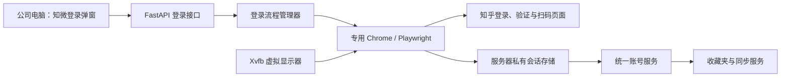

# 知乎页面内扫码登录实现方案

> 状态：实施中。无桌面浏览器、页面内安全验证画面、登录 API 和浏览器会话保存已接入；旧有效会话已验证重启恢复与收藏夹读取。当前服务器上的新验证码请求被知乎以 HTTP 403 拒绝，真实扫码成功仍待账号本人完成端到端验收。
> 编写日期：2026-09-29。
> 适用场景：知微运行在远程 Linux 服务器，公司电脑通过浏览器访问；服务器无需安装完整图形桌面。

## 1. 目标与实施前提

正常登录流程：**公司电脑打开知微 → 点击“登录知乎” → 手机知乎 App 扫码并确认 → 自动验证 → 开始同步。**

知乎要求安全验证时，在知微的登录弹窗内完成验证，再继续扫码。用户无需安装远程桌面客户端、操作服务器桌面、复制 Cookie 或执行命令。登录成功后保存会话，后端重启时自动恢复并校验；仅在知乎确认会话失效时要求重新登录。

采用 **Xvfb 虚拟显示器 + 普通 Google Chrome + Playwright CDP 接入**。Chrome 以有界面模式运行在虚拟显示器内，知微只传输登录页的二维码或验证画面。无桌面运行与知乎是否接受该服务器的网络环境是两件事；Xvfb 不保证消除安全验证或访问限制。

首版范围是单用户、单知乎账号、单后端进程，通过可信私人网络访问。浏览器的会话与文章目录分开存放。公众可访问、多用户共享的部署需要先补齐应用身份认证和账号隔离，不属于本轮范围。

## 2. 当前实现与已知限制

| 现有文件 | 当前行为 | 本次调整 |
| --- | --- | --- |
| `backend/app/services/zhihu_qr.py` | 用 HTTP 请求生成二维码并轮询；扫码会话可落盘 | 保留兼容入口，主入口改用真实浏览器登录 |
| `backend/app/services/zhihu_browser.py` | 启动 Chrome 或接入 CDP，通过页面验证账号；同步请求会话主要保存在内存 | 增加虚拟显示器支持、页面状态识别、画面与输入控制、会话恢复 |
| `backend/app/api/routes.py` | 提供 `/account`、连接、验证、退出、直接扫码接口 | 增加受会话令牌保护的页面内登录接口；统一账号来源 |
| `backend/app/main.py` | 仅在设置 CDP 地址时尝试恢复浏览器 | 启动时先恢复已保存会话，必要时启动专用浏览器复核 |
| `backend/app/services/sync.py` | 独立选择扫码或浏览器会话；部分访问错误按认证失效处理 | 使用统一账号服务，区分失效、验证、权限、限流和网络错误 |
| `frontend/src/App.tsx` | 分开提供扫码和浏览器入口；浏览器登录需要手动点验证 | 改成统一登录弹窗和自动状态更新 |

截至编写时的证据：

- 直接扫码流程曾在 `scan_info` 返回错误码 `40352`，需要安全验证。
- 本次检查真实 Chrome 时，它位于 `/account/unhuman`，页面标题为“安全验证 - 知乎”，尚未展示二维码。
- 历史浏览器会话曾成功验证账号并读取收藏夹，详见 [接入能力记录](zhihu-capabilities.md)；这不能证明本次无桌面扫码链路已成功。
- 已在不设置 `DISPLAY` 的隔离环境中启动 Xvfb 和普通 Chrome，实际到达知乎 `/account/unhuman` 安全验证页；页面内弹窗和受保护的画面接口可显示该页面。验证码接口在当前服务器返回 HTTP 403，尚未证明新扫码闭环可用。
- 从服务器旧 Chrome 配置目录恢复此前有效会话后，后端重启校验成功，收藏夹接口读取到两个收藏夹。此结果只验证已有会话的恢复及读取。

2026-09-29 实施检查：前端生产构建和后端 Ruff 检查通过；隔离 API 的无令牌画面访问返回 `403`，旧帧输入返回 `409`。这些检查不替代本节要求的真人扫码闭环。

`zhihu-cli` 使用相同的网页扫码接口，不能作为本轮限制的已验证解决办法。当前没有核实到可授权读取个人收藏夹的开发者 access token 方案。

## 3. 必须先完成的可行性验证

在实现完整前端前，先用最小后端探测程序完成以下闭环：

1. 在没有 `DISPLAY`、没有桌面环境的 Linux 会话中启动 Xvfb 和专用 Chrome。
2. 通过本机 CDP 连接 Chrome，固定视口，打开 `https://www.zhihu.com/signin`。
3. 遇到验证时提供临时的受限画面及点击、拖动输入，由账号本人完成；不自动识别或破解验证码。
4. 确认登录页能显示真正可用的二维码，并能截取完整图像。
5. 由账号本人用手机扫码并确认；通过真实 `/api/v4/me` 响应确认账号，再用同一会话读取收藏夹第一页。账号没有收藏夹时，合法的空列表也算通过。
6. 保存会话，终止探测程序及 Chrome，重新启动并验证账号、读取收藏夹。

**通过条件**：上述六步全部完成，有脱敏结果记录；不能用“二维码生成成功”代替“扫码登录成功”，也不能只检查 Cookie 是否存在。

**未通过时**：记录失败发生在页面、扫码确认、账号验证、收藏夹访问还是恢复阶段，并更新 `docs/zhihu-capabilities.md`。不得把目标方案标成已支持。若知乎持续拒绝该环境，暂停后续完整界面开发，保留已有本地资料功能并给出实际限制。

证据只记录时间、浏览器版本、阶段、HTTP 状态、脱敏错误码和通过项；不提交二维码、Cookie、私人账号 ID、收藏夹名称或文章正文。

## 4. 模块划分与调用关系



建议在现有服务层增加以下模块，不进行全仓库目录重构：

| 文件 | 职责 |
| --- | --- |
| `backend/app/services/zhihu_login.py`（新增） | 登录任务、所有者令牌、状态机、过期、轮询、画面与输入编排 |
| `backend/app/services/zhihu_display.py`（新增） | Xvfb 生命周期、动态显示编号、启动失败和资源清理 |
| `backend/app/services/zhihu_session.py`（新增） | 会话版本、字段过滤、原子保存、加载、校验和删除 |
| `backend/app/services/zhihu_account.py`（新增） | 统一有效账号来源，向路由、设置和同步提供一致状态及 `get_json()` |
| `backend/app/services/zhihu_browser.py` | Chrome 生命周期、知乎页面适配、账号验证、请求上下文 |
| `frontend/src/components/ZhihuLoginDialog.tsx`（新增） | 扫码、验证、过期、取消和错误界面 |
| `frontend/src/api.ts`、`frontend/src/types.ts` | 登录 API、响应类型与错误类型 |

`/account`、设置页和 `sync.py` 必须通过同一个账号服务选择会话。已经验证的会话优先；失败或过期的旧扫码任务不能覆盖仍然有效的浏览器账号状态。同步任务启动时绑定会话代次，避免中途静默切换账号。

## 5. 无桌面浏览器运行方式

### 5.1 启动与隔离

- 以运行知微的普通用户启动 Xvfb、Chrome；保留 Chrome 沙箱，不默认使用 `--no-sandbox`。
- Xvfb 使用动态显示编号，例如 `-displayfd`，不抢占服务器现有 `:0`；关闭 X TCP 监听并启用独立 Xauthority 文件。
- 只把专用 `DISPLAY`、`XAUTHORITY` 传给 Chrome 子进程，不修改整个后端的环境变量。
- Chrome 使用 `APP_HOME/browser-profile/zhihu-login/` 专用目录，目录权限 `0700`。不复用用户普通浏览器配置，也不直接混用历史 `zhihu-cdp`、`zhihu-chrome` 目录。
- Chrome 调试地址仅监听 `127.0.0.1`，使用动态端口；端口与 WebSocket 地址不返回前端。
- 固定浏览器视口为 `1280 × 900`、设备缩放为 `1`；Xvfb 分辨率须足够容纳浏览器窗口。前端缩放不改变服务器坐标系。
- 启动完成检查包括进程存活、显示器可连接、CDP 可连接、页面可用，不能只检查端口文件存在。

### 5.2 进程和并发

首版使用一个 Uvicorn worker，保证每实例最多一个浏览器控制器、一个交互式登录任务。用进程内异步锁及配置目录的进程锁双重防护；第二个后端进程应明确报配置冲突，不能共同写 Chrome 配置目录。

状态查询读取缓存，不启动新浏览器、不直接触发知乎请求。登录管理器负责唯一后台轮询任务。浏览器输入操作串行化；会话校验、同步网络请求不能长时间占用全局状态锁。

取消、过期、启动失败和后端退出时，清理未完成的输入、轮询任务、请求上下文、临时文件及本实例创建的子进程。先正常退出 Chrome，再停止 Xvfb；超时才终止进程。不能按进程名批量结束其他浏览器。

兼容外部 `ZHILIB_CHROME_CDP_URL` 仅作为诊断功能；主流程不依赖它，也不能自动终止外部浏览器或清除其全部 Cookie。

## 6. 登录状态与页面行为

账号状态与当前登录任务分开保存。新登录任务失败不应自动使原来已连接的账号退出。

| 登录任务状态 | 判定依据 | 页面行为 |
| --- | --- | --- |
| `starting` | 正在启动或加载浏览器 | “正在准备登录”，禁用重复提交 |
| `challenge_required` | 页面或明确接口响应要求人工验证 | 展示验证画面和操作提示 |
| `qr_ready` | 真实登录页有可见、完整的二维码 | 展示二维码和手机扫码说明 |
| `awaiting_confirmation` | 页面有可靠的已扫码证据 | “请在手机上确认登录” |
| `verifying` | 检测到可能完成登录，正在查询账号 | “正在验证账号” |
| `connected` | 实际校验成功，账号及请求会话可用 | 关闭画面传输，刷新账号和收藏夹 |
| `expired` | 知乎确认二维码过期，或整个任务超时 | 提供“重新生成” |
| `cancelled` | 所有者取消任务 | 关闭弹窗，释放本次资源 |
| `failed` | 启动失败、页面无法识别或不可恢复错误 | 显示可操作的原因和重试按钮 |

状态可在 `qr_ready`、`verifying` 与 `challenge_required` 之间回退；不能假定只有启动时会出现验证码。无法可靠识别“已扫码”时保持 `qr_ready`，不要推测成功。

登录任务默认有效期 10 分钟。二维码有效期优先取知乎可确认的信息；无法确认时不显示虚构倒计时，以页面过期提示和任务上限为准。二维码刷新需操作知乎页面的实际刷新入口，不能只重新截取旧图。

整个页面返回刷新后，可用 `sessionStorage` 中的任务 ID 与临时令牌继续查看；服务重启后，未完成任务失效并提示重新开始，已验证账号进入恢复流程。另一个标签页不能默认同时操作同一验证窗口。

## 7. HTTP 接口契约

以下为**拟新增接口**，统一使用 `/api/v1` 前缀。保留 `/account`、`/account/disconnect`；旧的连接、验证和直接扫码接口在前后端同时迁移期间保留兼容，不改变已有请求的响应形状。

| 方法与路径 | 用途 | 主要输入或输出 |
| --- | --- | --- |
| `POST /account/login` | 创建登录任务 | 输入 `request_id`；返回 `login_id`、临时 `control_token` 和状态快照 |
| `GET /account/login/{login_id}` | 读取任务缓存状态 | 返回 `state`、`revision`、安全提示、期限及画面模式 |
| `GET /account/login/{login_id}/frame` | 获取二维码或验证画面 | 返回帧 JSON，含 `frame_id`、图像和坐标元数据 |
| `POST /account/login/{login_id}/input` | 转发人工验证操作 | 输入 `frame_id`、单调序号和受限输入事件 |
| `POST /account/login/{login_id}/refresh` | 刷新二维码 | 同一任务内操作实际页面，返回新快照 |
| `DELETE /account/login/{login_id}` | 取消任务 | 清理本次任务；不退出原有已验证账号 |
| `GET /account` | 统一查询账号 | 保留 `status/message/profile`，可扩展 `reason`、`last_verified_at` |
| `POST /account/disconnect` | 退出账号 | 撤销活动登录任务，清理本应用保存的会话 |

任务创建成功后，所有该任务的读取、画面和控制请求均要求 `X-Zhilib-Login-Token` 请求头。令牌至少 256 位随机值，仅返回创建者；不放在 URL、日志或 `localStorage`。创建接口与所有写接口检查来源，并要求 JSON 或应用自定义请求头，配合明确的 CORS 白名单。

任务创建使用 `request_id` 做短期幂等处理，禁止双击启动多个浏览器。其他创建请求遇到活动任务返回 `409 login_in_progress`，不泄露令牌；令牌丢失时可在任务到期后重建。首版不提供无令牌接管控制窗口的接口。

公共 `/account` 只给出必要账号状态，不暴露活动任务令牌、二维码、CDP 地址或会话内容。私有网络访问控制仍是应用的部署前提；任务令牌只解决登录窗口所有权，不能替代应用身份认证。

状态响应示意：

```json
{
  "login_id": "<opaque-id>",
  "state": "qr_ready",
  "revision": 4,
  "message": "请用知乎 App 扫码，并在手机上确认",
  "expires_at": "<ISO-8601>",
  "qr_expires_at": null,
  "frame_mode": "qr",
  "can_refresh": true
}
```

二维码或验证帧返回 `image_data_url`、`frame_id`、`document_revision`、`viewport_width/height`、`clip_x/y/width/height`。图像只在内存中生成，响应设置 `Cache-Control: no-store`，前端退出弹窗立即释放。

接口错误统一包含稳定错误码和中文说明，例如 `browser_unavailable`、`display_unavailable`、`page_changed`、`login_in_progress`、`stale_frame`、`session_expired`。禁止把异常堆栈或原始知乎响应直接返回用户。

## 8. 二维码与人工验证实现

### 8.1 二维码

通过专用页面适配器识别登录页二维码容器，以 DOM 元素截图保留完整边框和留白；不解码、重建或改写二维码内容。选择器依据第一阶段观察结果确定，集中维护并用脱敏页面夹具覆盖。

前端显示清晰、等比例的二维码，避免模糊缩放。页面状态默认每 2 秒查询一次，图像仅在内容变更或刷新后更新；浏览器内部轮询与前端用户数量无关。手机确认后自动校验账号并读取收藏夹，用户随后点击“开始同步”。登录成功本身不自动启动全量同步。

不能仅凭二维码消失、出现 Cookie 或跳转到首页设置 `connected`。账号身份以真实接口响应为依据。收藏夹访问失败应单独提示原因，不伪造同步就绪。

### 8.2 验证画面与输入

首版采用截图轮询和受限输入接口，无需部署 VNC、WebSocket 远程桌面或完整网页代理。前端不能直接 iframe 嵌入知乎来共享服务器的登录态。

- 在需要验证且弹窗可见时，以约 1～2 帧/秒获取图像；隐藏时降低频率，完成后立即停止。
- 只截取验证区域；无法确定裁剪区域时，可退到专用登录页视口，不允许截取系统桌面、其他标签页或普通浏览器。
- 输入允许点击、滚动、按下/移动/松开、受限文本与按键；不开放任意 URL、JavaScript、文件上传/下载、系统剪贴板或开发者工具快捷键。
- 浏览器端视口固定。前端将图像坐标换算为裁剪区内坐标，后端再加 `clip_x/y`；校验边界、坐标、事件数量及速率。
- 输入携带 `frame_id` 与事件序号；文档导航、布局变更或裁剪区域改变后拒绝旧帧输入，返回 `409 stale_frame`。图像像素更新本身不能中断同一次拖动；拖动期间固定几何代次，导航时取消并释放按键。
- 鼠标拖动采用有序事件批次；服务端限制持续时间和频率，任务取消或输入超时必须补发松开事件。需要文本输入时，仅允许当前可见验证输入框，不记录原文。
- 主页面只允许经过审查的知乎登录、验证和登录后跳转地址。子资源域名按真实验证流程确认；不能把任意前端提交的地址加入白名单。跨域验证 iframe 若无法可靠操作，应明确提示并记录限制。

安全验证由用户本人完成。若特定验证依赖该方案无法提供的设备能力，显示实际限制，不循环伪装成功或自动处理验证码。

## 9. 会话持久化、恢复与退出

### 9.1 保存内容与写入时机

账号真实验证成功后，保存必要的知乎 Cookie、经确认需要的站点存储、浏览器 User-Agent、会话格式版本、账号最小信息和最后验证时间。按精确域名与 origin 过滤，不保存无关站点状态。

建议文件为 `APP_HOME/zhihu-browser-session.json`。`APP_HOME` 和浏览器目录权限 `0700`；会话及临时文件从创建时起就是 `0600`，在同目录原子替换，避免先用宽松权限写入再修改。拒绝符号链接和越出应用目录的路径，损坏或版本不兼容时给出恢复失败状态，不能反复崩溃。

浏览器配置目录作为恢复补充，不假定它与快照自动同步。通过同一管理器维护会话代次；保存成功且请求上下文就绪后，再向前端发布 `connected`。保存失败要提示“本次登录可用，但重启后需要重新连接”，不能声称已持久保存。

### 9.2 后端启动恢复

1. 初始化状态为 `restoring`，后台执行恢复，不阻塞文章库读取和健康检查。
2. 加载快照，建立请求上下文并校验 `/api/v4/me`，确认当前账号与保存记录一致。
3. 直接请求因浏览器环境要求无法判定时，启动专用 Chrome 恢复状态并通过页面复核；不导入其他 Chrome 配置目录。
4. 验证成功后发布 `connected`，更新快照；此后可以刷新收藏夹。
5. 明确失效时发布 `expired`；需要人工验证时发布 `challenge_required`，待用户点击登录后创建受保护的交互任务。
6. 超时、DNS 或临时网络故障发布 `unknown`/`network_error` 并保留快照，以有限退避重试；不能因暂时失败删除会话。

恢复期间收到登录请求，应与恢复任务协调，避免并行写配置目录或用迟到的恢复结果覆盖新登录。断开连接时增加会话代次，使在途校验结果失效。

### 9.3 请求错误与退出

- `401` 或明确认证过期响应：复核账号后标记失效，暂停依赖账号的任务。
- `40352`、验证页跳转或明确挑战响应：进入需要验证状态；不直接删除会话。
- 其他 `403`：可能是资源权限或请求受限，保留账号，返回对应错误并按需复核，不能一律要求重新登录。
- `429`：限流；有上限退避，遵守可用的 `Retry-After`，不改变登录状态。
- `5xx`、连接中断、超时：请求失败，保留会话；重试预算只由一层服务控制，避免嵌套无限重试。

显式“退出知乎”应取消登录任务、撤销请求上下文、清理浏览器与扫码快照，以及专用配置目录内的登录资料；关闭进程后再删除，避免浏览器退出时写回 Cookie。等待或终止在途同步请求，并阻止旧代次再次落盘。保留本地文章。

新登录取消时，只销毁候选会话，不删除原有已验证会话；候选浏览器使用单独临时配置目录，验证成功后原子切换会话来源。存在运行中的同步任务时，首版禁止切换账号并提示先停止同步。

旧 `zhihu-qr-session.json` 可在新快照缺失时作为兼容来源，必须实际校验。历史浏览器目录不自动搬移、删除或混合；迁移失败时保留原文件并提示重新扫码。

## 10. 前端交互

同步中心和设置页统一使用“登录知乎”入口；已登录时显示账号状态和退出按钮。技术细节如 Xvfb、CDP、服务器路径只进入管理员文档，不出现在日常登录步骤中。

登录弹窗包含二维码区、必要的验证画面、状态说明、刷新与取消按钮。状态切换保持在同一个弹窗内。验证成功后自动刷新账号与收藏夹，整个站点展示同一账号状态。

请求按顺序轮询，上一个未完成时不再发下一次；组件卸载时用 `AbortController` 取消前端请求。后端任务不因单次 HTTP 断开而被重复创建。关闭弹窗主动取消未完成任务；浏览器直接关闭时由任务上限回收。

错误提示必须说明用户能做什么，例如“二维码已过期，请刷新”“知乎要求先完成安全验证”“服务器浏览器启动失败，请联系管理员”。没有网络时不要将账号标签直接变为“未登录”。

## 11. 部署与配置

当前基础依赖已包含 Playwright；新增系统依赖为 Xvfb、Xauthority 工具、普通 Google Chrome 及其运行依赖。优先使用第一阶段实际通过的 Chrome 版本。Playwright Chromium 只能作为明确标注、经过实测的备用，不能静默切换后声称相同可用性。

拟新增配置如下，实施时在安全示例配置和用户指南中同步记录；这些配置目前尚未接入代码：

| 配置 | 建议默认值 | 含义 |
| --- | --- | --- |
| `ZHILIB_LOGIN_MODE` | `browser_qr` | 页面内浏览器扫码；保留 `legacy_api_qr` 用于回滚 |
| `ZHILIB_DISPLAY_MODE` | `xvfb` | 使用独立虚拟显示器；诊断时可显式选 `existing` |
| `ZHILIB_CHROME_EXECUTABLE` | 自动查找普通 Chrome | 管理员指定可执行文件，不能来自 HTTP 输入 |
| `ZHILIB_LOGIN_TIMEOUT_SECONDS` | `600` | 整个交互任务的时限 |
| `ZHILIB_LOGIN_POLL_SECONDS` | `2` | 浏览器状态轮询间隔；配置值需有上下限 |

继续使用 `ZHILIB_HOME` 指定私有运行目录，端口保持后端 `8010`、开发前端 `5173`。首版后端不得设置多个 worker。反向代理不缓存登录 API，并限制请求体大小；画面及输入通过已有应用入口传输，不向公司电脑暴露 Xvfb、CDP 或 VNC 端口。

远程访问使用可信私人网络，或具有应用认证的 HTTPS 部署。现有 CORS 只允许 `Content-Type`，实施时需明确加入登录令牌及应用请求头，继续校验来源；来源校验并不代替身份认证。主方案完成后检查临时 noVNC/VNC 服务是否仍被使用，确认闲置再停止，不能误停其他管理用途。

启动自检需分别报告缺少 Xvfb、Chrome 不可执行、目录不可写、显示认证失败、浏览器退出和知乎加载失败。日志只记录阶段与错误分类，不记录请求正文、Cookie、令牌、二维码和验证码输入。

## 12. 实施顺序与交付物

| 阶段 | 工作范围 | 通过条件与交付物 |
| --- | --- | --- |
| A：真实可行性 | Xvfb、Chrome、最小画面与输入、手机扫码、会话恢复探测 | 完成第 3 节闭环；更新脱敏接入能力记录，否则暂停后续完整开发 |
| B：浏览器与会话底层 | 显示器管理、专用目录、原子存储、恢复和退出 | 无桌面运行；重启恢复；退出后旧代次不能重建会话 |
| C：登录 API | 状态机、令牌、图像、受限输入、刷新、取消、超时 | 所有 API 有输入校验；并发只有一个控制者；旧帧输入被拒绝 |
| D：前端登录弹窗 | 二维码、验证画面、自动确认、错误提示 | 公司电脑仅用浏览器完成流程，无需远程桌面页面 |
| E：账号与同步整合 | 统一会话来源、兼容旧入口、错误分类 | 设置与同步状态一致；真实收藏夹和少量内容同步成功 |
| F：部署与回归 | 完成验收矩阵、更新配置及文档 | 无桌面、服务重启、异常恢复均有证据；能力记录只声明实测结果 |

每阶段完成后更新实际能力，不能仅凭代码合并就移除“待验证”说明。保留旧入口到新路径完成真实验收；前后端和接口版本一起发布，避免旧页面调用不兼容接口。

## 13. 验收矩阵

| 场景 | 预期结果 | 验证方式 |
| --- | --- | --- |
| 无桌面、未设置 `DISPLAY` | Xvfb 和 Chrome 启动，应用显示登录状态 | 真实无桌面环境运行 |
| 手机扫码确认 | 自动识别真实账号并读取收藏夹 | 本人账号人工验收 |
| 登录前或登录后出现验证 | 同一弹窗可点击、拖动，完成后继续 | 真实挑战 + 脱敏页面夹具 |
| 二维码过期、刷新 | 明确提示；实际二维码更新，旧帧失效 | 页面夹具及真实登录 |
| 后端和浏览器均重启 | 校验后恢复账号，不要求无故重扫 | 真实会话恢复验收 |
| 网络中断、403、40352、429 | 分别提示，不错误清除有效会话或无限重试 | 针对错误分支的模拟响应 |
| 两个标签页同时登录 | 仅一个控制者，其他返回冲突 | API 并发验证 |
| 缺少或错误令牌、恶意来源 | 无法读取画面或操作浏览器 | API 边界测试 |
| 越界坐标、旧帧、异常事件批次 | 拒绝请求，浏览器不执行非法输入 | API 边界测试 |
| 验证期间导航或取消拖动 | 不把操作发到新页面，释放按键 | 页面夹具与浏览器验证 |
| 会话文件损坏、软链接或越界路径 | 安全失败，不读写应用目录之外文件 | 临时目录测试 |
| 保存失败 | 当前会话状态明确，不声称持久化成功 | 文件写入失败注入 |
| 退出时恰好有在途恢复或同步 | 旧会话不能再次落盘或变成已连接 | 会话代次与并发测试 |
| 旧扫码状态残留 | 不覆盖已验证的浏览器账号 | 账号来源选择测试 |
| 前端构建及响应式交互 | 类型通过、二维码清晰、验证坐标正确 | `cd frontend && npm run build` + 人工检查 |

实现阶段在 `backend/tests/` 增加有意义的边界、状态和恢复覆盖，使用临时目录及脱敏夹具。自动测试不依赖真实知乎凭证。真实平台验收由账号本人扫码确认，结果不能被模拟响应代替。

## 14. 完成标准与回滚

全部满足后才可将本方案标记为已实现：

- 公司电脑通过知微页面完成二维码登录；遇到支持的安全验证时无需独立远程桌面。
- 无图形桌面的服务器可启动浏览器，账号及收藏夹验证成功。
- 后端重启后会话恢复经过真实验证；失效、网络错误和安全挑战可区分。
- 私有文件、画面和控制接口满足本文边界；退出能完整撤销本应用会话。
- 同步可用，前后端状态一致；用户指南、架构和能力记录与实测一致。

回滚采用保留的旧登录模式，保留文章资料与既有有效会话；新格式会话由版本字段区分，旧实现不得盲读。回滚只能恢复此前能力，不能宣称旧 HTTP 扫码接口已解除知乎限制。

上线前同步更新 `DESIGN.md`、`IMPLEMENTATION.md`、`docs/user-guide.md`、`docs/zhihu-capabilities.md` 及部署命令。`readme.md` 保留原始需求。
